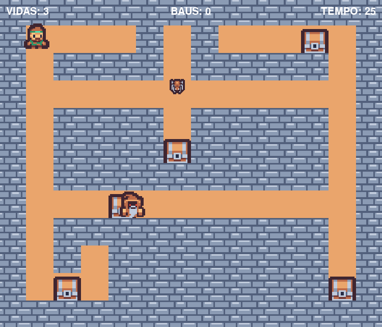

# Dungeon-Collector

**Um jogo de exploração e coleta desenvolvido em Python com Pygame Zero.**

Dungeon Collector é um mini-jogo 2D no qual o jogador assume o papel de um explorador em uma masmorra cheia de perigos. O objetivo é encontrar e coletar todos os baús espalhados pelo mapa antes que o tempo acabe, enquanto desvia de inimigos que patrulham o cenário.

O projeto foi desenvolvido como uma forma de demonstrar conhecimento no desenvolvimento de jogos com o Pygame Zero.

## Demonstração



## Como jogar

Explore a masmorra, colete todos os baús e tome cuidado com os inimigos!

**Controles:**

| Tecla | Ação |
|---|---|
| `W`, `A`, `S`, `D` | Movimentar o personagem |
| `↑`, `←`, `↓`, `→` | Movimentar o personagem |
| `R` | Reiniciar a partida |

**Regras:**
- Colete todos os baús espalhados pelo mapa para vencer.
- Evite os inimigos: cada colisão reduz uma vida.
- Você começa com 3 vidas.
- Complete o objetivo antes que o tempo de 30 segundos termine.
- Ao perder todas as vidas ou esgotar o tempo, a partida termina.

##  Funcionalidades implementadas

- **Movimentação do personagem:** deslocamento pelo mapa com animação e controle por teclado.
- **Sistema de colisão:** detecção de contato entre o jogador e os inimigos.
- **Inimigos com movimentação automática:** personagens que patrulham áreas específicas do cenário.
- **Sistema de coleta:** baús que mudam de aparência quando coletados.
- **Sistema de vidas:** gerenciamento de dano e vulnerabilidade temporária do personagem.
- **Temporizador:** limite de tempo para completar o desafio.
- **Condições de vitória e derrota:** diferentes estados para encerramento da partida.
- **Reinicialização:** possibilidade de iniciar uma nova partida sem fechar o jogo.
- **Trilha sonora:** música de fundo durante a experiência.

## 🛠️ Tecnologias utilizadas

- [Python 3.13.18](https://www.python.org/)
- [Pygame Zero 1.2.1](https://pygame-zero.readthedocs.io/)
- [Pygame 2.6.1](https://www.pygame.org/)

## 🚀 Como executar o projeto

**1. Clone o repositório:**

```bash
git clone https://github.com/MatheusViols/Dungeon-Collector
```

**2. Acesse a pasta do projeto:**

```bash
cd Dungeon-Collector
```

**3. Crie e ative um ambiente virtual (opcional, mas recomendado):**

```bash
python -m venv .venv
```

No Windows:

```bash
.venv\Scripts\activate
```

**4. Instale as dependências:**

```bash
pip install -r requirements.txt
```

**5. Execute o jogo:**

```bash
cd game
pgzrun game.py
```

## 📁 Organização do projeto

```text
Dungeon-Collector/
│
├── game/
│   ├── images/          # Imagens e sprites do jogo
│   ├── music/           # Trilha sonora
│   ├── game.py          # Inicialização e controle principal do jogo
│   ├── jogador.py       # Lógica e comportamento do jogador
│   ├── mapa.py          # Construção e regras do mapa
│   ├── mago.py          # Comportamento do mago
│   ├── aranha.py        # Comportamento da aranha
│   └── bau.py           # Lógica dos baús colecionáveis
│
├── requirements.txt     # Dependências do projeto
├── LICENSE              # Licença MIT
└── README.md
```
